# Smart Street

**A sourcing platform that connects India's street food vendors with verified raw-material suppliers.**


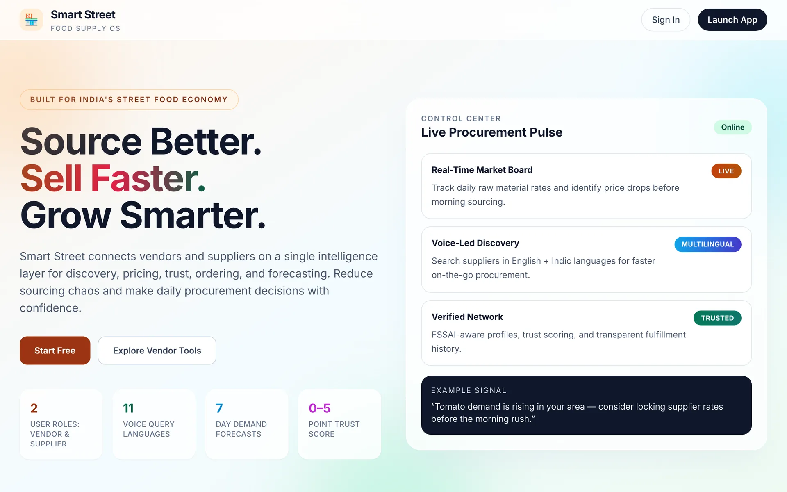

## Overview

Street food vendors buy onions, oil, spices and flour every morning, usually from whoever is nearby, with
little visibility into price, quality or reliability. Suppliers, in turn, struggle to predict demand and reach
new buyers.

Smart Street gives both sides one place to work:

- **Vendors** discover nearby suppliers, compare price, trust score and FSSAI status, pool demand with other
  vendors through group orders, place and track orders, and keep an eye on spending and recipe costs.
- **Suppliers** manage their catalogue and orders, verify their FSSAI licence, see demand forecasts and track
  how their business is doing.

The frontend is a React 19 + TypeScript single-page app (installable as a PWA). The backend is
[Convex](https://convex.dev), which provides the database, server functions, real-time subscriptions and
scheduled jobs.

> Originally built for the Tutedude Web Development Hackathon 1.0 ("Solving for Street Food").

## Table of contents

- [Screenshots](#screenshots)
- [Features](#features)
- [Tech stack](#tech-stack)
- [Architecture](#architecture)
- [Getting started](#getting-started)
- [Configuration](#configuration)
- [Usage](#usage)
- [Backend API reference](#backend-api-reference)
- [Scripts](#scripts)
- [Testing and quality](#testing-and-quality)
- [Deployment](#deployment)
- [Project structure](#project-structure)
- [Troubleshooting / FAQ](#troubleshooting--faq)
- [Known limitations and roadmap](#known-limitations-and-roadmap)
- [Contributing](#contributing)
- [License](#license)

## Screenshots

Captured from the running app with the seed data in `convex/sampleData.ts` (fictional businesses), using
`npm run ui:screenshots`.

| Vendor dashboard                                            | Supplier discovery                                        |
| ----------------------------------------------------------- | --------------------------------------------------------- |
| 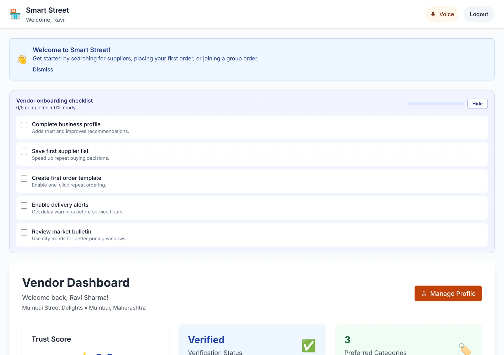 | 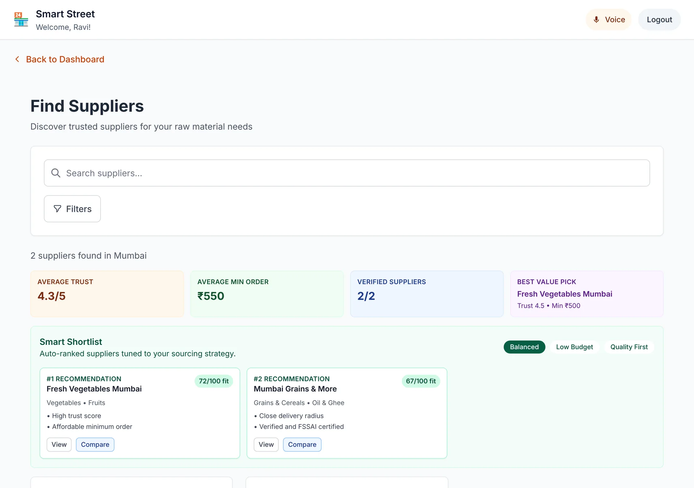 |

| Group orders                                               | Spending analytics                                             |
| ---------------------------------------------------------- | -------------------------------------------------------------- |
| 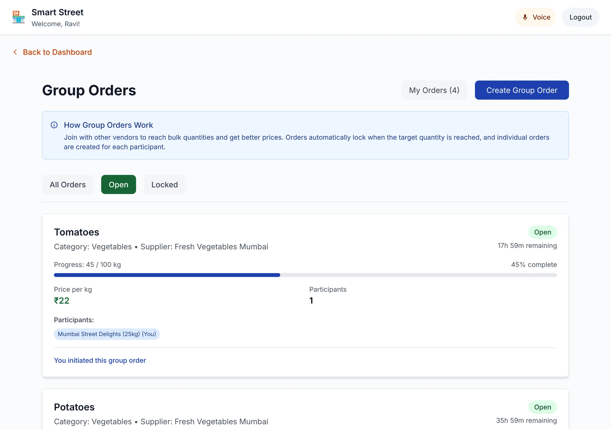 | 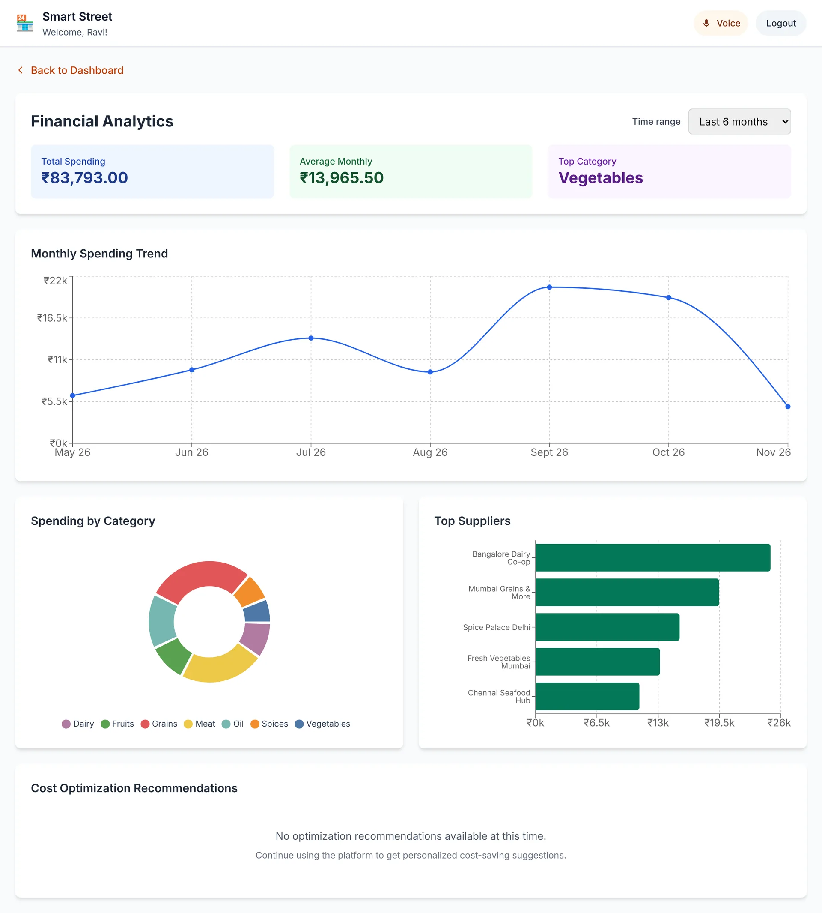 |

| Supplier catalogue                                            | Supplier analytics                                              |
| ------------------------------------------------------------- | --------------------------------------------------------------- |
| 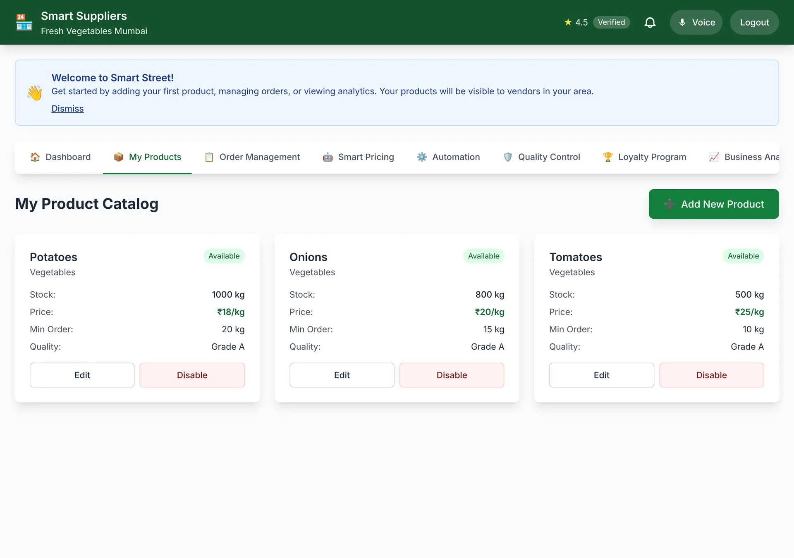 | 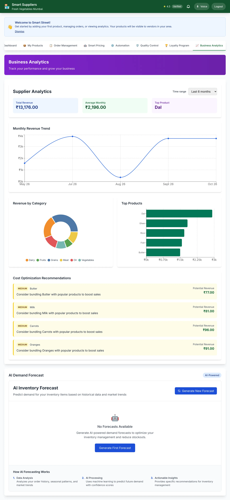 |

<details>
<summary>Mobile, tablet and other screens</summary>

| Landing (phone)                                          | Sign up (phone)                                            | Vendor dashboard (phone)                                                      |
| -------------------------------------------------------- | ---------------------------------------------------------- | ----------------------------------------------------------------------------- |
| 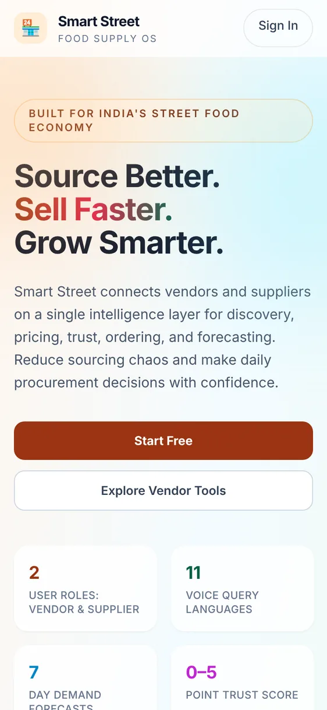 | 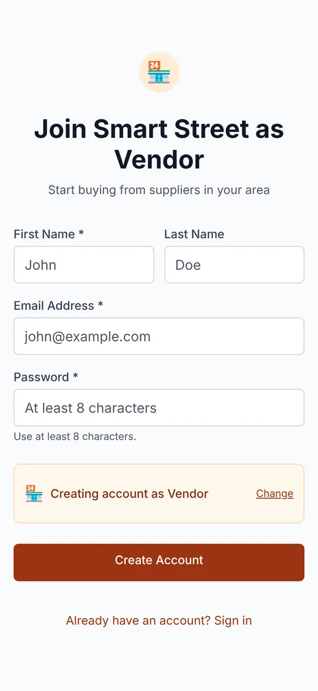 | 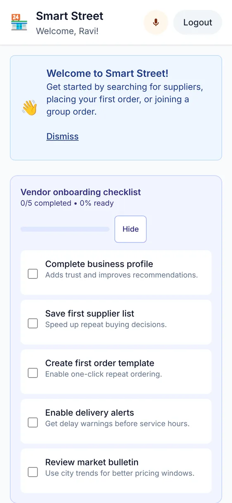 |

| Supplier catalogue (tablet)                                                       | Recipe costing                                          | 404 page                                           |
| --------------------------------------------------------------------------------- | ------------------------------------------------------- | -------------------------------------------------- |
| 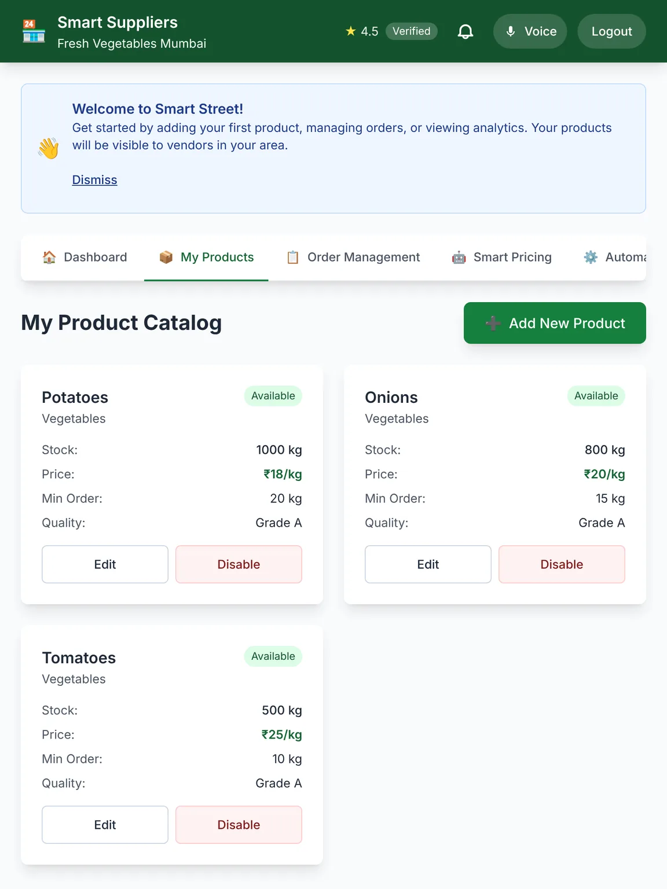 | 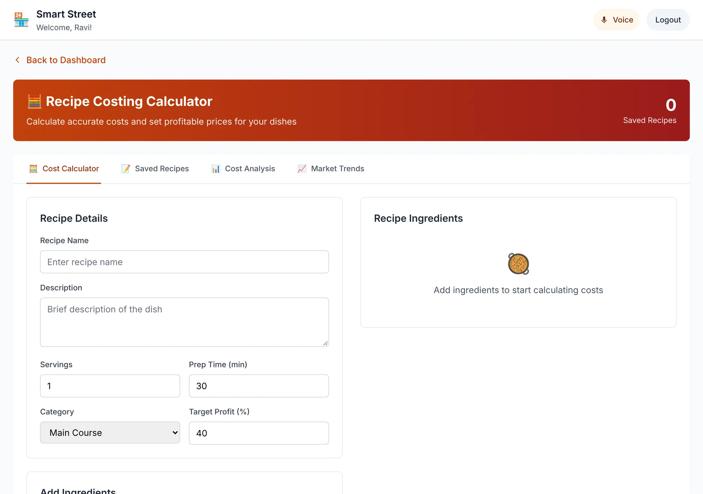 |  |

</details>

## Features

### For vendors

| Feature             | What it does                                                                                                                                                         |
| ------------------- | -------------------------------------------------------------------------------------------------------------------------------------------------------------------- |
| Supplier discovery  | Search and filter suppliers by city, category, price, trust score and FSSAI certification.                                                                           |
| Smart shortlist     | Suppliers ranked by a weighted score of distance, trust, category match, price and stock availability (`convex/recommendations.ts`).                                 |
| Voice queries       | Speak a request in English or one of 10 Indian languages. Speech is transcribed with Sarvam AI and turned into search filters by an LLM, with a rule-based fallback. |
| Orders and tracking | Place orders and follow status and delivery updates in real time.                                                                                                    |
| Group orders        | Pool demand with nearby vendors for bulk pricing. Scheduled jobs lock groups that hit their target and expire stale ones.                                            |
| Business tools      | Spending analytics, recipe costing calculator, procurement planner, negotiation hub and market-intelligence notes.                                                   |

### For suppliers

| Feature                    | What it does                                                                                                                                                                     |
| -------------------------- | -------------------------------------------------------------------------------------------------------------------------------------------------------------------------------- |
| Catalogue management       | Add products, edit price, stock and minimum order, and toggle availability.                                                                                                      |
| Order management           | Accept and progress orders and add tracking updates.                                                                                                                             |
| Demand forecasting         | 7-day forecasts per product that consider order history and Indian seasons and festivals. Runs daily and on demand; falls back to a deterministic seasonal model with no AI key. |
| FSSAI licence verification | Upload a certificate image. Text is extracted with OCR.space, fields are parsed by an LLM, then checked against the profile (licence format, name similarity, expiry).           |
| Trust score                | A 0–5 score built from ratings, completed orders, on-time delivery, certification and verification.                                                                              |
| Analytics and pricing      | Revenue analytics, smart-pricing suggestions and inventory automation rules.                                                                                                     |

### Platform

- Email/password accounts with a vendor or supplier role. Passwords are stored as salted PBKDF2-SHA256 hashes.
- Responsive from 375 px phones up to desktop, keyboard accessible with visible focus, and checked against
  WCAG 2.1 AA with axe-core (see [Testing and quality](#testing-and-quality)).
- Installable PWA with an offline banner, and a Google Translate language bar for regional languages.

> The **Quality Control** and **Loyalty Program** supplier tabs currently show illustrative sample data. They
> are not backed by Convex tables yet.

## Tech stack

| Layer          | Technology                                                                 |
| -------------- | -------------------------------------------------------------------------- |
| UI             | React 19, TypeScript 5.8, React Router 7, Tailwind CSS 3, Recharts         |
| Build          | Vite 7, vite-plugin-pwa (Workbox)                                          |
| Backend / data | Convex: queries, mutations, actions, cron jobs, real-time sync             |
| AI services    | OpenRouter (LLMs), Sarvam AI (speech-to-text), OCR.space (certificate OCR) |
| Testing        | Vitest, Testing Library, MSW, convex-test, Playwright, axe-core            |
| Tooling        | ESLint (typescript-eslint), Prettier, GitHub Actions                       |
| Deployment     | Any static host (Vercel config included) or Docker + nginx; Convex Cloud   |

## Architecture

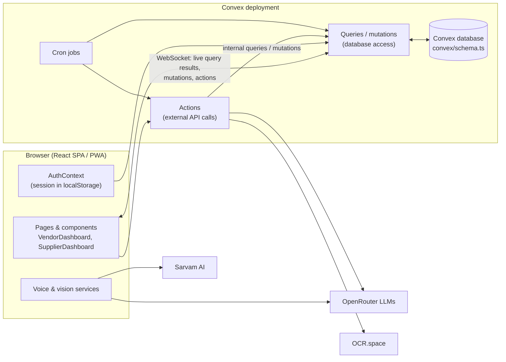

Key design points:

- **Reactive data.** Components subscribe with `useQuery`, so lists and dashboards update live when data
  changes.
- **External calls only in actions.** Convex queries and mutations must be deterministic and can't call
  external APIs. AI forecasting and FSSAI verification therefore run as **actions** that read data through
  internal queries and write through internal mutations (`convex/suppliers.ts`,
  `convex/fssaiVerification.ts`).
- **Pure domain logic** lives in `convex/lib/` (forecasting, FSSAI checks, trust score, password hashing,
  the OpenRouter client) and is unit-tested in isolation.
- **Server secrets stay server-side.** `OPENROUTER_API_KEY` and `OCR_SPACE_API_KEY` are Convex environment
  variables and never reach the browser.
- **Scheduled jobs** (`convex/crons.ts`): lock full group orders every minute, expire group orders every
  5 minutes, and regenerate demand forecasts daily at 02:00 UTC.
- **Resilient UI.** Each dashboard section has its own error boundary, so one failing query shows an error
  card instead of a blank page.

## Getting started

### Prerequisites

- **Node.js 20 or newer** (CI uses Node 22) and npm
- A free **[Convex](https://convex.dev) account**, for your own backend
- Optional: API keys for OpenRouter, Sarvam AI and OCR.space to enable the AI features

### 1. Clone and install

```bash
git clone https://github.com/jeevithg090/Smart-Vendors-Suppliers.git
cd Smart-Vendors-Suppliers
npm ci
```

### 2. Start the Convex backend

```bash
npx convex dev
```

On first run this asks you to log in, creates a dev deployment, pushes the schema and functions, regenerates
`convex/_generated/` and writes `CONVEX_DEPLOYMENT` and `VITE_CONVEX_URL` to `.env.local`. Leave it running;
it redeploys functions as you edit them.

### 3. (Optional) Load demo data

The seed functions are internal, so run them from the CLI:

```bash
npx convex run sampleData:addSampleSuppliers
npx convex run sampleData:addSampleVendor
npx convex run sampleData:addSampleGroupOrders
npx convex run sampleData:addSampleRatings
npx convex run sampleData:addSampleFinancialRecords
```

### 4. Configure environment variables

```bash
cp .env.example .env.local   # keep the values `npx convex dev` wrote, add any API keys you have
```

Server-side keys go on the Convex deployment, not in `.env.local`:

```bash
npx convex env set OPENROUTER_API_KEY <your-key>   # AI forecasts + FSSAI field extraction
npx convex env set OCR_SPACE_API_KEY <your-key>    # FSSAI certificate OCR
```

### 5. Run the app

```bash
npm run dev          # http://localhost:5173
```

For a production build served locally:

```bash
npm run build
npm run preview      # http://localhost:4173
```

## Configuration

Frontend variables are read by Vite **at build time**. Every `VITE_*` value ends up in the JavaScript bundle
and is **public**, so use keys you can restrict to your domain.

| Variable                        | Where        | Required               | Default                                  | Description                                                    |
| ------------------------------- | ------------ | ---------------------- | ---------------------------------------- | -------------------------------------------------------------- |
| `VITE_CONVEX_URL`               | `.env.local` | Recommended            | Public demo backend in `src/main.tsx`    | URL of your Convex deployment (`https://<name>.convex.cloud`). |
| `CONVEX_DEPLOYMENT`             | `.env.local` | Dev only               | Written by `npx convex dev`              | Which deployment the Convex CLI targets.                       |
| `VITE_SARVAM_API_KEY`           | `.env.local` | For voice queries      | —                                        | Sarvam AI speech-to-text.                                      |
| `VITE_OPENROUTER_API_KEY`       | `.env.local` | For voice queries      | — (rule-based parsing is used)           | LLM that turns spoken requests into filters.                   |
| `VITE_GOOGLE_TRANSLATE_API_KEY` | `.env.local` | No                     | —                                        | Translation fallback for voice queries.                        |
| `VITE_VISION_API_KEY`           | `.env.local` | No                     | —                                        | Google Vision, for ingredient photo recognition.               |
| `VITE_CLARIFAI_API_KEY`         | `.env.local` | No                     | —                                        | Clarifai, an alternative vision provider.                      |
| `VITE_AZURE_VISION_API_KEY`     | `.env.local` | No                     | —                                        | Azure Computer Vision key.                                     |
| `VITE_AZURE_VISION_ENDPOINT`    | `.env.local` | With the Azure key     | —                                        | Azure Computer Vision endpoint.                                |
| `VITE_TTS_API_KEY`              | `.env.local` | No                     | —                                        | Placeholder for a future text-to-speech integration.           |
| `OPENROUTER_API_KEY`            | Convex env   | No                     | — (deterministic forecast is used)       | AI demand forecasts and FSSAI certificate field extraction.    |
| `OCR_SPACE_API_KEY`             | Convex env   | For FSSAI verification | — (verification is recorded as rejected) | OCR for uploaded FSSAI certificates.                           |
| `CONVEX_DEPLOY_KEY`             | CI secret    | For CI deploys         | —                                        | Lets `npx convex deploy` run non-interactively.                |

## Usage

### UI walkthrough

1. Open the app and choose **Start Free** or **Sign In**, then pick a role: **Vendor** or **Supplier**.
2. Sign up with your name, email and a password of at least 8 characters. A vendor or supplier profile is
   created automatically.
3. **Vendor:** use the dashboard cards to _Find Suppliers_ (search, filter, compare), _Join Group Orders_,
   _Place and Track Orders_, cost a recipe or check _View Analytics_. Use the **Voice** button in the header to
   search by speech.
4. **Supplier:** complete the store profile, add products under **My Products**, process orders under
   **Order Management**, and open **Business Analytics** for revenue charts and demand forecasts. Verify your
   FSSAI licence from the **Store Profile** tab.

### Calling the backend directly

Convex functions are also reachable over HTTP. For example, signing up a vendor:

```bash
curl -s https://<your-deployment>.convex.cloud/api/mutation \
  -H 'Content-Type: application/json' \
  -d '{
        "path": "auth:authenticateUser",
        "format": "json",
        "args": {
          "email": "asha@example.com",
          "password": "masala-chai-42",
          "role": "vendor",
          "firstName": "Asha",
          "lastName": "Rao",
          "isSignup": true
        }
      }'
```

```json
{
  "status": "success",
  "value": {
    "success": true,
    "user": {
      "id": "asha@example.com",
      "email": "asha@example.com",
      "firstName": "Asha",
      "lastName": "Rao",
      "role": "vendor",
      "profileId": "<convex document id>"
    }
  }
}
```

Queries work the same way through `/api/query`:

```bash
curl -s https://<your-deployment>.convex.cloud/api/query \
  -H 'Content-Type: application/json' \
  -d '{"path": "suppliers:searchSuppliers", "format": "json", "args": {"city": "Mumbai"}}'
```

`npm run test:api` runs a scripted smoke test of the main public functions against a live deployment
(`scripts/api-smoke-check.mjs`).

## Backend API reference

The backend is a set of Convex functions rather than REST routes. A function is addressed as
`module:function` (the file name in `convex/` plus the export), through the React hooks (`useQuery`,
`useMutation`, `useAction`) or the HTTP endpoints `/api/query`, `/api/mutation` and `/api/action`.

**Auth column:** the app uses lightweight email/password auth. _Public_ functions need no session. _Email_
functions take the caller's email or profile id as an argument and look up the matching profile; they do
**not** verify a server-issued token (see [limitations](#known-limitations-and-roadmap)). _Internal_ functions
can only be called by other Convex functions, cron jobs or `npx convex run`.

| Type     | Function                                                                     | Auth     | Description                                                            |
| -------- | ---------------------------------------------------------------------------- | -------- | ---------------------------------------------------------------------- |
| mutation | `auth:authenticateUser`                                                      | Public   | Sign up (`isSignup: true`) or log in. Returns the user and profile id. |
| query    | `auth:getUserProfile`                                                        | Public   | Vendor or supplier profile for an email.                               |
| query    | `suppliers:searchSuppliers`                                                  | Public   | Search suppliers by city, category, trust score and FSSAI status.      |
| query    | `suppliers:getSupplierDetails`                                               | Public   | Supplier profile with inventory and ratings.                           |
| mutation | `suppliers:create` / `suppliers:update`                                      | Email    | Create or update a supplier profile.                                   |
| action   | `suppliers:generateForecastForSupplier`                                      | Public   | Build and store a 7-day demand forecast (AI or deterministic).         |
| query    | `suppliers:getSupplierForecasts`                                             | Public   | Latest stored forecast for a supplier.                                 |
| action   | `fssaiVerification:verifyFSSAICertificate`                                   | Public   | OCR + LLM verification of an uploaded FSSAI certificate.               |
| query    | `fssaiVerification:getFSSAIVerificationStatus`                               | Public   | Verification status and extracted certificate data.                    |
| mutation | `inventory:addInventoryItem` / `updateInventoryItem` / `deleteInventoryItem` | Email    | Manage a supplier's catalogue.                                         |
| query    | `inventory:getAvailableInventory`                                            | Public   | In-stock items, optionally filtered by supplier, category or name.     |
| mutation | `orders:createOrder` / `updateOrderStatus` / `cancelOrder`                   | Email    | Order lifecycle.                                                       |
| query    | `orders:getVendorOrders` / `getOrdersBySupplier` / `getOrderDetails`         | Email    | Order lists and details.                                               |
| mutation | `orderTracking:addTrackingInfo` / `updateTrackingStatus`                     | Email    | Delivery tracking events.                                              |
| mutation | `groupOrders:createGroupOrder` / `joinGroupOrder` / `leaveGroupOrder`        | Email    | Group buying.                                                          |
| query    | `groupOrders:getGroupOrdersByLocation`                                       | Public   | Open group orders near a location.                                     |
| mutation | `ratings:addRating` / `updateRating`                                         | Email    | Rate a supplier after an order; recalculates the trust score.          |
| query    | `ratings:getTrustScoreBreakdown`                                             | Public   | Trust score and the factors behind it.                                 |
| mutation | `recommendations:generateRecommendations`                                    | Email    | Rank suppliers for a vendor and store the shortlist.                   |
| mutation | `messages:sendMessage`                                                       | Email    | Direct message between vendor and supplier.                            |
| query    | `messages:getConversation`                                                   | Email    | Messages between two users.                                            |
| query    | `notifications:getUserNotifications`                                         | Email    | Notifications for the signed-in user.                                  |
| mutation | `priceAlerts:createPriceAlert`                                               | Email    | Alert a vendor when an item drops below a target price.                |
| mutation | `requests:createDemandRequest`                                               | Email    | Post a demand request that suppliers can respond to.                   |
| internal | `suppliers:generateInventoryForecast`                                        | Internal | Daily cron: forecasts for every supplier with orders and inventory.    |
| internal | `groupOrders:expireGroupOrders` / `checkAndLockOrders`                       | Internal | Cron jobs for the group-order lifecycle.                               |
| internal | `sampleData:*`, `sampleSuppliers:*`, `test:*`                                | Internal | Seed, cleanup and diagnostic helpers.                                  |

The remaining modules (`analytics`, `financialAnalytics`, `marketIntelligence`, `negotiations`, `recipes`,
`support`, `vendors`, `voiceQuery`, `imageAnalysis`) follow the same pattern. The schema for every table is
in `convex/schema.ts`.

## Scripts

| Command                               | Description                                                              |
| ------------------------------------- | ------------------------------------------------------------------------ |
| `npm run dev`                         | Start the Vite dev server on port 5173.                                  |
| `npm run dev:backend`                 | Run `convex dev` (push functions, regenerate types, watch for changes).  |
| `npm run build`                       | Type-check and build the production bundle into `dist/`.                 |
| `npm run preview`                     | Serve the production build on port 4173.                                 |
| `npm run lint`                        | ESLint across the app, backend, tests and scripts.                       |
| `npm run format`                      | Format everything with Prettier (`format:check` only verifies).          |
| `npm run typecheck`                   | Type-check the app and the Convex functions.                             |
| `npm test`                            | Unit and integration tests (Vitest).                                     |
| `npm run test:coverage`               | Tests with V8 coverage.                                                  |
| `npm run test:e2e`                    | Playwright end-to-end tests against the backend in `VITE_CONVEX_URL`.    |
| `npm run test:e2e:mock`               | The same e2e suite against an in-memory backend (no deployment needed).  |
| `npm run test:api`                    | Smoke-test a live deployment's public functions.                         |
| `npm run ui:audit`                    | Accessibility (axe) and overflow audit of every page at 375/768/1280 px. |
| `npm run ui:screenshots`              | Regenerate the README screenshots.                                       |
| `npm run deploy:backend`              | Deploy the Convex functions (`npx convex deploy`).                       |
| `npm run docker:build` / `docker:run` | Build and run the production Docker image on port 8080.                  |

## Testing and quality

| Layer                     | Location                                | What it covers                                                                                                                                                                                                       |
| ------------------------- | --------------------------------------- | -------------------------------------------------------------------------------------------------------------------------------------------------------------------------------------------------------------------- |
| Domain unit tests         | `src/test/convex/*.test.ts`             | Forecasting, FSSAI validation and name matching, trust score, password hashing, the OpenRouter fallback client.                                                                                                      |
| Backend integration tests | `src/test/convex/*.integration.test.ts` | The real Convex functions run in memory with [convex-test](https://www.npmjs.com/package/convex-test): sign-up/login, the forecast action and cron, end-to-end FSSAI verification, ratings → trust score, messaging. |
| Frontend tests            | `src/test/**`                           | Validation, retry/timeout helpers, error handling, voice processing and React components (Vitest + Testing Library + MSW).                                                                                           |
| End-to-end                | `e2e/`                                  | Sign-up, role routing, duplicate-account and wrong-role errors, 404, offline handling, and the core vendor and supplier journeys, on desktop and mobile Chrome.                                                      |
| Accessibility and layout  | `scripts/ui/audit.ts`                   | axe-core WCAG 2.x A/AA rules on every page and dashboard tab at three widths, plus a horizontal-overflow check.                                                                                                      |

```bash
npm test                 # 271 tests; no API keys or network needed
npm run test:e2e:mock    # starts the dev server and runs Playwright with the in-memory backend
npm run build && (npm run preview &) && npm run ui:audit
```

**How the in-memory backend works.** `scripts/ui/mockBackend.ts` loads every module in `convex/` into
convex-test, seeds it with the sample-data functions, and answers the Convex browser client's WebSocket sync
protocol through Playwright's `page.routeWebSocket`. The UI therefore runs against the real backend code
without a deployment. That's what the mocked e2e run, the accessibility audit and the screenshots use.

To use an already-installed Chromium with Playwright, set `PLAYWRIGHT_CHROMIUM_EXECUTABLE=/path/to/chrome`.

**Linting and formatting.** ESLint (typescript-eslint, React Hooks rules) and Prettier are enforced in CI.
`@typescript-eslint/no-explicit-any` is a warning while the remaining loose types are tightened.

**CI.** `.github/workflows/ci.yml` runs on every pull request and every push to `main`: install, lint, format
check, type-check (app and Convex), unit tests, production build, and `npm audit` on production
dependencies.

## Deployment

### 1. Backend (Convex)

```bash
npx convex deploy                                  # or: CONVEX_DEPLOY_KEY=... npx convex deploy (CI)
npx convex env set OPENROUTER_API_KEY <key> --prod
npx convex env set OCR_SPACE_API_KEY <key> --prod
```

### 2. Frontend

Build with `VITE_CONVEX_URL` pointing at the production deployment, then host `dist/` on any static host
with an SPA fallback to `index.html`.

- **Vercel.** `vercel.json` sets the build command, SPA rewrites, long-lived caching for hashed assets, and
  security headers. The CSP allows Convex (HTTPS + WebSocket), the AI APIs the browser calls, and Google
  Translate. Add `VITE_CONVEX_URL` in the project's environment settings.
- **Docker.** A multi-stage build serves the app with nginx as a non-root user on port 8080, with the same
  security headers (`deploy/nginx.conf`, `deploy/security-headers.conf`):

  ```bash
  docker build --build-arg VITE_CONVEX_URL=https://<deployment>.convex.cloud -t smart-street .
  docker run -p 8080:8080 smart-street     # health check: GET /health
  ```

If you call another external API from the browser, add its host to `connect-src` in **both** `vercel.json`
and `deploy/security-headers.conf`.

## Project structure

```
├── convex/                     # Backend (deployed to Convex)
│   ├── schema.ts               #   Database tables and indexes
│   ├── auth.ts                 #   Email/password sign-up and login
│   ├── suppliers.ts            #   Supplier profiles, search, forecasting actions
│   ├── fssaiVerification.ts    #   FSSAI certificate verification action
│   ├── groupOrders.ts          #   Group buying + cron handlers
│   ├── orders.ts, orderTracking.ts, inventory.ts, ratings.ts, …
│   ├── crons.ts                #   Scheduled jobs
│   ├── sampleData.ts           #   Internal seed data
│   ├── lib/                    #   Pure, unit-tested logic: forecasting, fssai, trustScore,
│   │                           #   password, identity, openRouter
│   └── _generated/             #   Generated by `npx convex dev` (do not edit)
├── src/                        # Frontend
│   ├── main.tsx, App.tsx       #   Bootstrapping and routes
│   ├── pages/                  #   HomePage, VendorDashboard, SupplierDashboard, NotFoundPage
│   ├── components/             #   Feature components (search, orders, group orders, voice, analytics…)
│   ├── contexts/AuthContext.tsx#   Session, login and sign-up
│   ├── services/               #   AI service clients, error reporting, performance monitoring
│   ├── hooks/, utils/          #   Validation, retry/timeout, voice processing, form helpers
│   ├── config/                 #   Feature config, chart colours, security settings
│   └── test/                   #   Vitest suites (incl. test/convex for backend tests)
├── e2e/                        # Playwright specs and the optional in-memory backend fixture
├── scripts/
│   ├── ui/                     #   In-memory backend, accessibility audit, screenshot capture
│   └── api-smoke-check.mjs     #   Live deployment smoke test
├── deploy/                     # nginx config and security headers for the Docker image
├── docs/                       # Screenshots and additional guides
├── .github/workflows/ci.yml    # Continuous integration
├── Dockerfile, vercel.json     # Deployment configuration
└── tailwind.config.js          # Design tokens (accessible colour palette)
```

## Troubleshooting / FAQ

**The app loads but shows no data or spins forever.**
`VITE_CONVEX_URL` probably points to the wrong deployment, or `npx convex dev` isn't running. Vite reads env
variables at startup, so restart `npm run dev` after changing them.

**"Could not find public function …" errors.**
The deployment doesn't have the latest functions. Run `npx convex dev` (development) or `npx convex deploy`
(production).

**Login says "Invalid email or password" for an account that worked before.**
Passwords are now hashed and checked. Accounts created before that change set their password on their first
successful login; after that, only that password works. There's no password-reset flow yet.

**Demand forecasts look simple.**
Without `OPENROUTER_API_KEY` on the Convex deployment, forecasts use the deterministic seasonal model.

**FSSAI verification is always "rejected".**
Set `OCR_SPACE_API_KEY` (and `OPENROUTER_API_KEY`) on the Convex deployment. The rejection reason is stored
and shown in the UI.

**Voice search does nothing.**
It needs `VITE_SARVAM_API_KEY`, microphone permission, and HTTPS (or `localhost`).

**The language bar doesn't appear.**
It stays hidden until the Google Translate widget has loaded, so it won't show if `translate.google.com` is
blocked.

**Playwright complains that browsers aren't installed.**
Run `npx playwright install chromium`, or point `PLAYWRIGHT_CHROMIUM_EXECUTABLE` at an existing Chromium.

## Known limitations and roadmap

**Limitations**

- **Authentication is lightweight.** Sessions live in the browser, and Convex functions trust the email or
  profile id passed as an argument instead of verifying a server-issued token. Moving to
  [Convex Auth](https://labs.convex.dev/auth) or another identity provider is the most important next step
  before handling real user data.
- **Some API keys are public.** `VITE_*` keys (Sarvam, OpenRouter for voice parsing, vision providers) are
  exposed to the browser. Proxy those calls through Convex actions to keep them private.
- **No password reset or email verification.**
- **Some data is illustrative.** The Quality Control and Loyalty Program tabs show sample data.
- **No dark mode.** Colours are hard-coded light-theme utility classes across about 50 components.
- **Loose types remain.** About 260 `any` types are left (lint warnings).

**Roadmap ideas**

- Token-based auth with per-function authorization checks.
- Server-side proxies for voice and vision providers.
- Persist quality checks and loyalty programmes in Convex.
- Payments and invoicing for orders.
- Dark mode via design tokens.
- Notifications through WhatsApp/SMS for order updates.

## Contributing

1. Fork the repo and create a branch from `main`.
2. `npm ci`, then run `npx convex dev` and `npm run dev` (or use `npm run test:e2e:mock` with no backend).
3. Keep changes focused. Before opening a PR, run:

   ```bash
   npm run lint && npm run format:check && npm run typecheck && npm test && npm run build
   ```

4. Add tests for new backend logic (pure helpers in `convex/lib/` plus a convex-test integration test where it
   makes sense), and run `npm run ui:audit` for UI changes.
5. Use [Conventional Commits](https://www.conventionalcommits.org/) for commit messages.

## License

No license file has been added yet, so all rights are reserved by default. If you intend others to use or
contribute to this project, consider adding an open-source license such as MIT.
